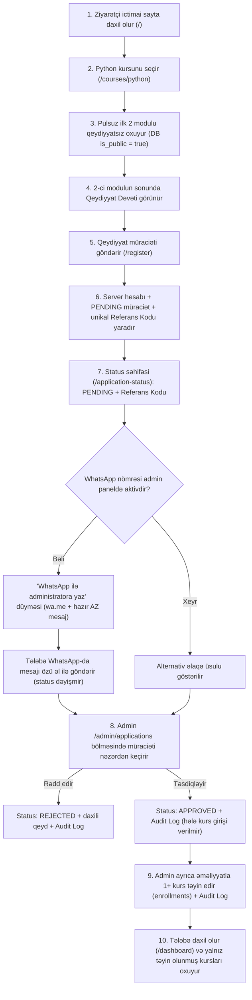

# Faza 1 — Brend Konsepsiyası və Məhsul Arxitekturası

> **Status:** Təsdiq gözləyir (Faza 1)  
> **Layihə:** Çoxkurslu Onlayn Proqramlaşdırma Akademiyası (Scalable LMS Platform)  
> **İlkin Tədris Dili:** Azərbaycan dili (gələcək dillər üçün genişlənə bilən arxitektura)  
> **İlkin Kurs:** Python Proqramlaşdırma (gələcəkdə C++, SQL, JavaScript, Web Dev, DSA, Data Science, ML, AI)

---

## 1. Brend Strategiyası və 5 Akademiya Adı Təklifi

Akademiyanın brendi aşağıdakı meyarlara cavab verməlidir:
- Tək bir proqramlaşdırma dilinə (məsələn, yalnız Python-a) bağlı olmamalı, gələcək bütün texniki kursları əhatə edə bilməlidir.
- Həm Azərbaycan, həm də beynəlxalq auditoriya üçün asan tələffüz olunmalı, yadda qalmalı və etibar yaratmalıdır.
- Tədris fəlsəfəsini — *sadə izah, aydın struktur, praktik məşq və yüksək keyfiyyət* — əks etdirməlidir.

### Variant 1: **Axioma Academy** *(Akademik-Təməl & Premium)*
- **Mənası:** Riyaziyyat və kompüter elmində *aksiom* — mürəkkəb sistemlərin üzərində qurulduğu ən sadə, aydın təməl prinsipdir. Akademiyanın mürəkkəb anlayışları sadə təməllərə bölüb izah etmə fəlsəfəsini birbaşa ifadə edir.
- **Brend şəxsiyyəti:** Etibarlı, nüfuzlu, metodik, sakit özünəinamlı; keyfiyyətli ali təhsil və müasir rəqəmsal məhsul balansı.
- **Loqo istiqaməti:** Minimalist həndəsi `A` simvolu — iki simmetrik xəttin içində birləşdirici blok/nöqtə (təməl prinsip və yüksəliş metaforası), təmiz geometrik sans-serif tipoqrafiya ilə (`Plus Jakarta Sans` / `Inter`).
- **Təklif olunan rəng palitrası:**
  - Primary (Əsas): Deep Navy `#0F172A`
  - Brand Accent (Vurğu): Royal Sapphire `#2563EB`
  - Secondary Accent (İkinci vurğu): Soft Teal `#0D9488`
  - Background / Surface: Warm Off-White `#F8FAFC` / Pure White `#FFFFFF`
  - Semantic Success / Warning / Error: `#10B981` / `#F59E0B` / `#EF4444`
- **Beynəlxalq genişlənməyə uyğunluq:** **Əla.** İngilis, Azərbaycan, türk və əksər Avropa dillərində eyni məna və prestij daşıyır; Python-dan Süni İntellektə qədər bütün sahələrə uyğundur.

### Variant 2: **Solvio** *(və ya Solvio Academy — Müasir EdTech & Problem-Həlli)*
- **Mənası:** *Solve* (məsələ həll etmək) və *I/O* (*Input / Output* — kompüter elminin əsası) anlayışlarının sintezi. Proqramlaşdırmanı əzbərləmə deyil, problem həll etmə vərdişi kimi təqdim edir.
- **Brend şəxsiyyəti:** Müasir, dinamik, əlçatan, praktik və motivasiyaedici; sıfırdan başlayanlar üçün qorxuducu olmayan, amma texnoloji cəhətdən güclü startap/EdTech xarakteri.
- **Loqo istiqaməti:** Terminal işarəsi (`>_`) və ya axın xəttindən formalaşan səliqəli `S` monoqramı; yumşaq künclü, yüksək oxunaqlı modern şrift.
- **Təklif olunan rəng palitrası:**
  - Primary: Slate Charcoal `#111827`
  - Brand Accent: Electric Indigo `#4F46E5`
  - Secondary Accent: Mint Emerald `#10B981`
  - Background / Surface: Cool Snow `#F9FAFB` / Pure White `#FFFFFF`
  - Semantic Warning / Error: `#F59E0B` / `#EF4444`
- **Beynəlxalq genişlənməyə uyğunluq:** **Əla.** Qısa (6 hərf), ritmik, Azərbaycan və ingilis dillərində eyni tələffüz olunur; qlobal EdTech platforması kimi asan miqyaslanır.

### Variant 3: **Syntaxa** *(Təmiz Texniki & Strukturlaşdırılmış)*
- **Mənası:** Proqramlaşdırma dillərinin quruluş və məntiq qaydalarını ifadə edən *syntax* sözündən törəyib. Hər bir texnologiyanı sistemli və aydın ardıcıllıqla mənimsətməyi simvolizə edir.
- **Brend şəxsiyyəti:** Dəqiq, peşəkar, mühəndis yanaşmalı, aydın və səliqəli; keyfiyyətli proqramlaşdırma mədəniyyətini vurğulayır.
- **Loqo istiqaməti:** Minimalist kod mötərizələri (`⟨ ⟩`) və ya iki kəsişən zolaqdan ibarət modern nişan + təmiz sans-serif tipoqrafiya.
- **Təklif olunan rəng palitrası:**
  - Primary: Midnight Ink `#0B1220`
  - Brand Accent: Deep Cobalt `#1D4ED8`
  - Secondary Accent: Sky Cyan `#06B6D4`
  - Background / Surface: Alabaster `#F8FAFC` / Pure White `#FFFFFF`
  - Semantic Success / Warning / Error: `#16A34A` / `#D97706` / `#DC2626`
- **Beynəlxalq genişlənməyə uyğunluq:** **Çox yüksək.** Proqramlaşdırma dünyasında universal tanınan kökdən gəlir, dil sərhədi tanımır, heç bir konkret proqramlaşdırma dilinə bağlı deyil.

### Variant 4: **Kodera** *(İsti, Səmimi & Yeni Nəsil Akademiya)*
- **Mənası:** *Kod* (*Code*) + *Era* (yeni dövr) birləşməsi — proqramlaşdırmanı sıfırdan öyrənərək yeni rəqəmsal dövrə addım atan tələbələrin akademiyası.
- **Brend şəxsiyyəti:** Səmimi, insan-yönümlü, ruhlandırıcı; "proqramlaşdırma hər kəs üçün əlçatan ola bilər" mesajını güclü şəkildə ötürür.
- **Loqo istiqaməti:** İrəli istiqamətlənmiş ox (`>`) elementi daxil edilmiş yuvarlaq künclü `K` monoqramı — davamlı irəliləyişi simvolizə edir.
- **Təklif olunan rəng palitrası:**
  - Primary: Deep Graphite `#18181B`
  - Brand Accent: Blue-Violet `#4338CA`
  - Secondary Accent: Warm Amber `#F59E0B`
  - Background / Surface: Warm Neutral `#FAFAF9` / Pure White `#FFFFFF`
  - Semantic Success / Error: `#16A34A` / `#DC2626`
- **Beynəlxalq genişlənməyə uyğunluq:** **Yüksək.** Azərbaycan, Türkiyə və regionda dərhal doğma və yadda qalan səslənir; qlobal bazarda da asan tələffüz olunur (*qeyd:* domen seçərkən `kodera.*` mövcudluğu və beynəlxalq `C/K` yazılış fərqi yoxlanılmalıdır).

### Variant 5: **Stepwise Academy** *(Pedaqoji & Addım-Addım Öyrənmə)*
- **Mənası:** İngilis dilində "addım-addım, ardıcıl və məntiqli şəkildə" deməkdir. Platformanın əsas üstünlüyü olan pedaqoji ardıcıllığı (izah → nümunə → kod → məşq → yoxlama) birbaşa adın özündə daşıyır.
- **Brend şəxsiyyəti:** Səbirli, pedaqoji cəhətdən güclü, aydın, sakit və inamverici; heç bir mərhələni buraxmadan öyrətməyə fokuslanır.
- **Loqo istiqaməti:** Yüksələn 3 minimalist pilləkən bloku (modullar arası proqressiv keçid simvolu) + balanslı humanist sans-serif şrift.
- **Təklif olunan rəng palitrası:**
  - Primary: Forest Slate `#0F2922`
  - Brand Accent: Deep Emerald `#059669`
  - Secondary Accent: Steel Blue `#2563EB`
  - Background / Surface: Paper Light `#F7F9F8` / Pure White `#FFFFFF`
  - Semantic Warning / Error: `#D97706` / `#DC2626`
- **Beynəlxalq genişlənməyə uyğunluq:** **Əla.** Qlobal bazarda dərhal başa düşülür, Azərbaycan auditoriyası üçün də sadə və müasirdir; istənilən texniki kurs istiqamətinə genişlənə bilir.

> **Qeyd:** Ad seçildikdən sonra real domen (`.com`, `.az`, `.academy`) və ticarət nişanı (trademark) mövcudluğu Faza 9-dan (Production) əvvəl rəsmi registrlərdə yoxlanılmalıdır.

---

## 2. Məhsul Strukturu və Səhifə Xəritəsi (Product & Information Architecture)

Platforma vahid tətbiq daxilində **3 inteqrasiya olunmuş təcrübədən** ibarətdir. Hər bir sahənin öz layout-u, naviqasiyası və server tərəfindən qorunan giriş qaydaları var.

### A. İctimai Vebsayt (Public Website)
*Giriş hüququ: Hamı üçün açıq (autentifikasiya tələb olunmur).*

| Marşrut (Route) | Səhifə | Məqsəd və Əsas Bölmələr |
| :--- | :--- | :--- |
| `/` | Ana Səhifə (Home) | Dəyər təklifi, tədris fəlsəfəsi, aktiv Python kursu + gələcək kurs yol xəritəsi, 4 addımlıq qəbul prosesi, pulsuz 2 modula birbaşa CTA |
| `/courses` | Kurslar Kataloqu | Dərc olunmuş kursların kartları (örtük şəkli, səviyyə, müddət, modul sayı, "Pulsuz giriş modulları" nişanı), gələcək kurslar üçün filtr strukturu |
| `/courses/:slug` | Kurs Detalları | Kurs təsviri, öyrənmə məqsədləri, tam kurikulum (modullar və dərslər: DB-dən gələn `Pulsuz` / `Qeydiyyatlı` statusu), ilk dərsə keçid və ya müraciət CTA |
| `/courses/:slug/lessons/:lessonSlug` | İctimai Dərs Oxuyucu | Yalnız `is_public = true` və `published` modulların dərsləri; tam strukturlaşdırılmış dərs blokları; 2-ci pulsuz modulun sonunda və ya məhdud dərsə cəhddə **Qeydiyyat Dəvəti** |
| `/about` | Akademiya Haqqında | Missiya, pedaqoji metodologiya, çoxkurslu vizyon, rəsmi əlaqə məlumatları |
| `/register` | Qeydiyyat Müraciəti | Ad-soyad, email, şifrə, istəyə bağlı telefon və öyrənmə məqsədi; Zod + RHF validasiya; göndərildikdə `PENDING` müraciət yaradılır |
| `/login` | Giriş | Email + şifrə ilə giriş, "Şifrəni unutdum" keçidi, rola/statusa uyğun avtomatik yönləndirmə (`/admin`, `/dashboard` və ya `/application-status`) |
| `/forgot-password` & `/reset-password` | Şifrə Bərpası | Supabase Auth üzərindən təhlükəsiz şifrə yeniləmə axını |
| `/application-status` | Müraciət Statusu | Müraciət statusu (`PENDING`, `APPROVED`, `REJECTED`), unikal referans nömrəsi, admin tənzimləmələrindən gələn **"WhatsApp ilə administratora yaz"** düyməsi (və ya alternativ əlaqə) |
| `/privacy` | Məxfilik Siyasəti | İstifadəçi məlumatlarının toplanması, saxlanması və qorunması qaydaları |
| `/terms` | İstifadə Şərtləri | Platformadan istifadə qaydaları, giriş və təsdiq şərtləri |

### B. Tələbə Paneli (Student Dashboard)
*Giriş hüququ: Yalnız autentifikasiya olunmuş, `role = 'student'`, təsdiqlənmiş (`APPROVED`) və aktiv (`account_status = 'active'`) istifadəçilər.*

| Marşrut (Route) | Bölmə | Məqsəd və Funksionallıq |
| :--- | :--- | :--- |
| `/dashboard` | Ümumi Baxış | Tələbə xülasəsi, "Qaldığın yerdən davam et" kartı, aktiv təyin edilmiş kurslar, tamamlanmış dərslər və quiz statistikası |
| `/dashboard/courses` | Mənim Kurslarım | Yalnız admin tərəfindən təyin olunmuş (`enrollments`) kurslar; hələ kurs təyin olunmayıbsa aydın məlumatlandırıcı boş vəziyyət |
| `/dashboard/courses/:slug` | Kurs Kurikulumu | Modul və dərs siyahısı, hər dərsin tamamlanma statusu, modul və kurs üzrə irəliləyiş faizi |
| `/dashboard/courses/:slug/lessons/:lessonSlug` | İnteraktiv Dərs Mühiti | Strukturlaşdırılmış bloklar (mətn, şəkil, kod, izah, nümunə, qeyd, xəbərdarlıq, xülasə), interaktiv məşq sahəsi (Faza 7-də Pyodide Worker), quiz bloku, "Tamamlandı" işarəsi və növbəti dərs keçidi |
| `/dashboard/progress` | Öyrənmə İrəliləyişi | Kurslar üzrə irəliləyiş qrafiki/kartları, tamamlanmış dərslər siyahısı, məşq və quiz cəhdləri tarixçəsi |
| `/dashboard/profile` | Tələbə Profili | Şəxsi məlumatlar, öyrənmə məqsədi, müraciət/qeydiyyat məlumatları (yalnız icazəli sahələr redaktə olunur) |
| `/dashboard/settings` | Hesab Tənzimləmələri | Şifrə dəyişikliyi, sessiyadan çıxış (rol, təsdiq statusu və kurs girişi dəyişdirilə bilməz) |

### C. Admin Paneli (Admin Dashboard)
*Giriş hüququ: Yalnız `role = 'admin'` olan və server tərəfindən təsdiqlənən istifadəçilər.*

| Marşrut (Route) | Bölmə | Məqsəd və Funksionallıq |
| :--- | :--- | :--- |
| `/admin` | Ümumi Baxış və Statistika | Gözləyən müraciətlər, təsdiqli/dondurulmuş tələbələr, dərc olunmuş kurslar/dərslər, son inzibati əməliyyatlar |
| `/admin/applications` | Qeydiyyat Müraciətləri | Status üzrə filtr (`PENDING`, `APPROVED`, `REJECTED`), axtarış, müraciət detalları, **Təsdiqlə / Rədd et**, daxili admin qeydləri |
| `/admin/students` & `/admin/students/:id` | Tələbə İdarəetməsi | Axtarış/filtr, profil detalları, hesabı dondurma/aktivləşdirmə, öyrənmə irəliləyişinə baxış, kurs təyinatlarının idarəsi |
| `/admin/enrollments` | Kurs Təyinatları | Tələbələrə bir və ya bir neçə kurs təyin etmə, mövcud təyinatları ləğv etmə, bütün aktiv giriş icazələrinə baxış |
| `/admin/courses` & `/admin/courses/:id` | Kurs İdarəetməsi | Kurs yaratma/redaktə, `draft` / `published` / `archived` idarəsi, örtük şəkli yükləmə (Supabase Storage), çətinlik, dil, təxmini müddət |
| `/admin/courses/:id/modules` | Modul İdarəetməsi | Modul yaratma/redaktə, sıralama (`order_index`), **ictimai / məhdud (`is_public`)** konfiqurasiyası, dərc/arxiv |
| `/admin/modules/:id/lessons` & `/admin/lessons/:id/editor` | Dərs, Məşq və Quiz Redaktoru | Kod yazmadan sıralı blok redaktəsi (11 blok növü), şəkil yükləmə, kod bloku (dil + syntax highlighting), məşq və test halları, quiz və suallar, dərc/gizlət |
| `/admin/settings` | Platforma və WhatsApp Tənzimləmələri | Akademiya adı, loqo, əlaqə emaili, WhatsApp nömrəsi, WhatsApp düyməsinin görünürlüyü, alternativ əlaqə üsulu, qeydiyyatın açıq/bağlı olması, pulsuz modul parametrləri |
| `/admin/audit-logs` | Fəaliyyət Jurnalı | Bütün inzibati əməliyyatların (kim, nə vaxt, hansı qeyd üzərində nə dəyişdi) süzülə bilən, silinməyən tarixçəsi |

---

## 3. Əsas İstifadəçi Axınları (Main User Journeys)

### Axın 1: Ziyarətçidən Təsdiqlənmiş Tələbəyə (End-to-End Qəbul Prosesi)

### WhatsApp Mesajının Hazırlanma Qaydası
- Format: `https://wa.me/{CLEAN_PHONE_NUMBER}?text={URL_ENCODED_MESSAGE}`
- Nümunə Azərbaycanca prefilled mesaj:
  > Salam! {Akademiya Adı} platformasında qeydiyyatdan keçdim və müraciətimin nəzərdən keçirilməsini xahiş edirəm.
  > Ad və soyad: {Tələbənin Adı}
  > Email: {Tələbənin Emaili}
  > Müraciət nömrəsi: {APP-YYYY-XXXXXX}
- **Təhlükəsizlik prinsipi:** WhatsApp linkinin açılması və ya mesaj göndərilməsi **heç vaxt** sistemdə təsdiq əməliyyatı başlatmır; yeganə səlahiyyətli mexanizm adminin server tərəfindən təsdiqlənən əməliyyatıdır.

### Axın 2: Tələbə Öyrənmə Dövrü
1. Tələbə `/dashboard`-da təyin edilmiş kursa klikləyir və qaldığı dərsə keçir.
2. Dərsi pedaqoji ardıcıllıqla oxuyur: *Sadə izah → Real nümunə → Kod bloku (kopyalama + sintaksis rəngləmə) → Kodun izahı → Vacib qeyd/Xəbərdarlıq → İnteraktiv məşq → Quiz → Qısa xülasə*.
3. Məşqi brauzerdə izolyasiya olunmuş Web Worker daxilində sınaqdan keçirir (Faza 7) və test hallarının nəticəsini görür.
4. Quiz-i cavablayır, ani izahlı rəy alır.
5. Dərsi tamamlayır → `lesson_progress` yenilənir → Kursun irəliləyiş faizi avtomatik hesablanır.

### Axın 3: Giriş Nəzarəti və Müdafiə Axını (Access Control)
- **Anonim ziyarətçi məhdud dərsə keçsə:** RLS və server məzmunu qaytarmır → UI Qeydiyyat Dəvəti göstərir.
- **`PENDING` / `REJECTED` istifadəçi `/dashboard`-a keçsə:** Avtomatik `/application-status` səhifəsinə yönləndirilir; məhdud dərs sorğuları serverdən bloklanır.
- **`APPROVED` tələbə təyin edilməmiş kursa keçsə:** RLS məlumatı qaytarmır; "Bu kurs hesabınıza təyin olunmayıb" mesajı göstərilir.
- **Tələbə `/admin` və ya `/api/admin/*` ünvanına müraciət etsə:** Server JWT + DB rol yoxlaması `403 Forbidden` qaytarır.

### Axın 4: Adminin Çoxkurslu Məzmun Genişləndirmə Dövrü
1. Admin `/admin/courses` bölməsində yeni kurs (məsələn, C++, SQL, JS) yaradır (`draft`).
2. Modullar əlavə edir, sıralayır və hansı modulların ictimai (`is_public`) olacağını təyin edir.
3. Dərs redaktorunda kod dəyişmədən blokları, şəkilləri, kod nümunələrini, məşqləri və quiz-ləri əlavə edir.
4. Kursu və modulları `published` edir → İctimai kataloqda görünür və tələbələrə təyin edilə bilər.

---

## 4. Əsas Funksional və Keyfiyyət Tələbləri (Core Requirements)

### Funksional Tələblər
- **FR-01 — İctimai Kəşfiyyat və Konfiqurasiya Olunan Pulsuz Giriş:** İctimai modullar frontend kodunda hardcode edilmir; DB-də modul səviyyəsində `is_public` bayrağı və admin panelindən idarə olunur.
- **FR-02 — Qeydiyyat Müraciəti və Referans Kodu:** Bütün daxiletmələr həm client, həm server tərəfində Zod ilə yoxlanılır; unikal referans kodu serverdə yaradılır; ilkin status həmişə `PENDING` olur.
- **FR-03 — WhatsApp Əlaqə Kanalı:** Nömrə və düymə görünürlüyü `platform_settings`-dən oxunur; nömrə yoxdursa düymə gizlədilir və ya alternativ əlaqə göstərilir; avtomatik göndəriş yoxdur.
- **FR-04 — Ayrılmış Təsdiq və Kurs Təyini:** Müraciətin təsdiqlənməsi yalnız tələbə hesabını aktivləşdirir; kurslara giriş ayrıca `enrollments` qeydləri ilə verilir və ləğv edilə bilir.
- **FR-05 — Strukturlaşdırılmış Çoxkurslu CMS:** 11 blok növü (`heading`, `paragraph`, `image`, `code`, `explanation`, `example`, `note`, `warning`, `exercise`, `quiz`, `summary`), sıralama, `draft/published/archived` dövrü, gələcək dillər üçün `locale` dəstəyi.
- **FR-06 — Tədris İrəliləyişi və Qiymətləndirmə:** Dərs tamamlanması, məşq cəhdləri, quiz nəticələri, kurs üzrə tamamlanma faizi.
- **FR-07 — Təhlükəsiz İnteraktiv Python İcrası (Faza 7):** Yalnız brauzer Web Worker-ində Pyodide icrası, zaman limiti (timeout), sonsuz döngü dayandırma, əvvəlcədən təyin olunmuş test halları; backend-də tələbə kodu icra olunmur.
- **FR-08 — Platforma Tənzimləmələri və Audit Log:** Akademiya ayarları yalnız admin tərəfindən dəyişdirilir; bütün həssas admin əməliyyatları `audit_logs` cədvəlində qeydə alınır.

### Qeyri-Funksional Tələblər
- **Təhlükəsizlik:** `SUPABASE_SERVICE_ROLE_KEY` yalnız serverdə; bütün həssas cədvəllərdə PostgreSQL RLS; client-dən gələn rol heç vaxt etibarlı sayılmır; server-side rate limiting.
- **Performans:** İndekslənmiş sorğular, siyahılarda pagination, şəkillərin optimallaşdırılması, Pyodide-in lazy-loading ilə yüklənməsi.
- **UX və Əlçatanlıq:** Mobile-first responsive dizayn (360px–1440px+), aydın yüklənmə/xəta vəziyyətləri, WCAG 2.1 AA kontrast və klaviatura əlçatanlığı.

---

## 5. İlkin Python Kursu — İlk 2 Pulsuz Modulun Pedaqoji Çərçivəsi

*(Məzmunun tam mətnləri və tapşırıqları Faza 6–7-də sizinlə birlikdə detallı hazırlanacaq; aşağıda struktur təklifi verilmişdir.)*

### Modul 1: Proqramlaşdırmaya İlk Addım *(İctimai — `is_public = true`)*
1. **Dərs 1.1:** Proqramlaşdırma nədir? Kompüter təlimatları necə oxuyur? *(Sıfır texniki jarqon, gündəlik həyat nümunələri)*
2. **Dərs 1.2:** İlk Python kodun: `print()` ilə ekrana mətn çıxarmaq *(Kod nümunəsi + sətirbəsətir izah + ilk mini-tapşırıq)*
3. **Dərs 1.3:** Dəyişənlər (*Variables*): Məlumatı qutularda saxlamaq *(Real analogiya + kod + praktik məşq)*
4. **Dərs 1.4:** Mətn və Rəqəmlər (əsas məlumat növləri) + Modul 1 Mini-Quiz və Xülasə

### Modul 2: Proqramın Düşünməsi və İstifadəçi ilə Ünsiyyət *(İctimai — `is_public = true`)*
1. **Dərs 2.1:** İstifadəçidən məlumat almaq (`input()`) — interaktiv salamlayıcı proqram
2. **Dərs 2.2:** Python ilə hesablamalar: sadə riyazi əməliyyatlar və real nümunələr
3. **Dərs 2.3:** Qərar vermək: `if` və `else` şərtləri *(Həyatdan aydın qərar ağacları ilə)*
4. **Dərs 2.4:** Modul 2 Yekun Praktikası (kiçik interaktiv proqram) + Yekun Quiz → **Qeydiyyat Dəvəti (3-cü modul və tam kursa keçid)**
