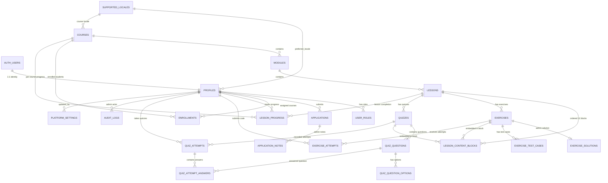
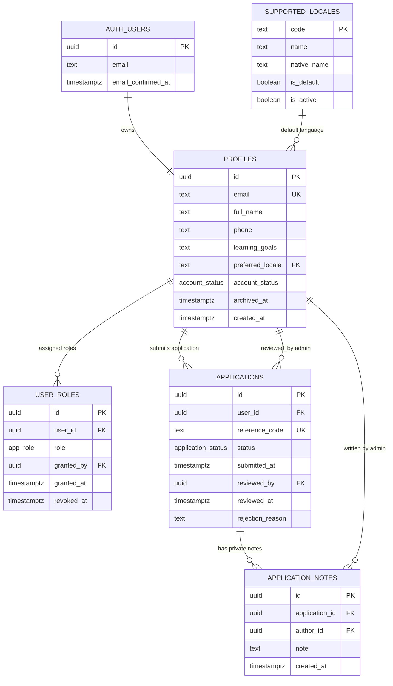
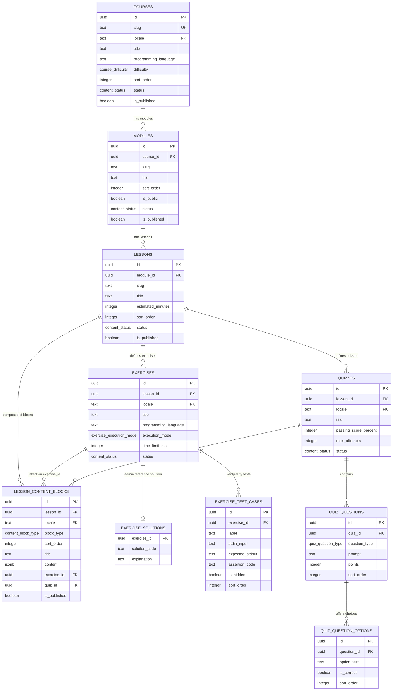
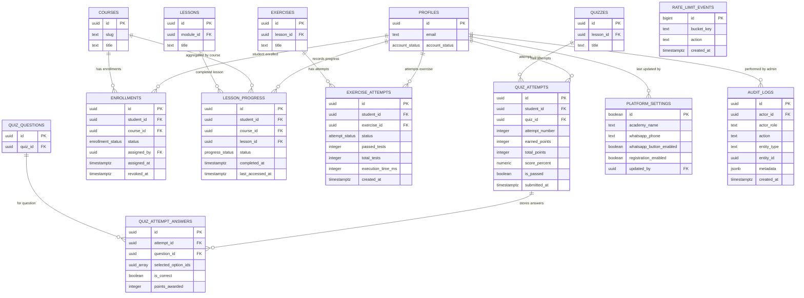

# Kodera — Faza 2: Entity-Relationship Diaqramları (`02-entity-relationship-diagram.md`)

> **Məqsəd:** Kodera LMS verilənlər bazasının bütün cədvəlləri və əlaqələrinin vizual xəritəsi.  
> **Əlaqəli sənəd:** [02-database-architecture.md](file:///c:/Users/LENOVO/Desktop/Py_Course/docs/02-database-architecture.md)

---

## 1. Ümumi Sistem ER Diaqramı (Bütün Əsas Cədvəllər)

---

## 2. Domen 1: İstifadəçi, Rollar və Qeydiyyat Müraciəti

---

## 3. Domen 2: Çoxkurslu Tədris Kontenti, 11 Blok, Məşq və Quiz

---

## 4. Domen 3: Kurs Təyinatları, Tələbə İrəliləyişi, Cavablar və Audit

---

## 5. Əsas Biznes Əlaqələrinin Xülasəsi

| Əlaqə | Kardinalıq | Necə Modelləşdirilib? |
| :--- | :---: | :--- |
| Bir istifadəçinin profili | `1 : 1` | `profiles.id` birbaşa `auth.users(id)` üzərində PK + FK-dır |
| Bir istifadəçinin müraciəti | `1 : 1` (aktiv) / `1 : N` (tarixçə) | `applications.user_id -> profiles.id`; qismən unikal indeks eyni vaxtda yalnız 1 `pending`/`approved` müraciətə icazə verir |
| Bir kursun çoxlu modulu | `1 : N` | `modules.course_id -> courses.id`, `sort_order` ilə sıralanır |
| Bir modulun çoxlu dərsi | `1 : N` | `lessons.module_id -> modules.id`, `sort_order` ilə sıralanır |
| Bir dərsin çoxlu kontent bloku | `1 : N` | `lesson_content_blocks.lesson_id -> lessons.id`, `(lesson_id, locale, sort_order)` üzrə sıralanır |
| Bir tələbənin çoxlu kurs təyinatı | `N : M` (`enrollments` vasitəsilə) | `enrollments(student_id, course_id)` unikal cütlüyü; təsdiqdən tam ayrı idarə olunur |
| Bir tələbənin çoxlu quiz cavabı | `1 : N : M` | `profiles -> quiz_attempts (1:N) -> quiz_attempt_answers (1:N) -> quiz_questions` |
| Bir tələbənin fərqli kurslar üzrə irəliləyişi | `1 : N` | `lesson_progress(student_id, course_id, lesson_id)` unikal `(student_id, lesson_id)` və `(student_id, course_id, status)` indeksi ilə |
