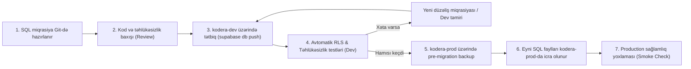

# Kodera — Faza 2: SQL Miqrasiya Planı və Mühit İdarəetməsi (`02-sql-migrations-plan.md`)

> **VACİB QEYD:** Bütün SQL miqrasiya faylları Faza 2 çərçivəsində **ilkin layihə (draft)** kimi hazırlanıb. Sizin açıq təsdiqiniz olmadan heç bir real Supabase layihəsində **icra edilməyib** və edilməyəcək.

---

## 1. Ardıcıl və Versiyalaşdırılmış Miqrasiya Faylları

Bütün miqrasiyalar `supabase/migrations/` qovluğunda zaman damğası + ardıcıllıq prefiksi (`YYYYMMDDNNNN_name.sql`) ilə saxlanılır. Hər miqrasiya yalnız bir dəfə, ciddi ardıcıllıqla icra olunur və mövcud obyektlərdə təkrarlanmayan (*idempotent-safe*) qoruyucu ifadələrdən (`IF NOT EXISTS`, `CREATE OR REPLACE`) istifadə edir.

| # | Fayl | Məqsəd | Asılılıq |
| :-: | :--- | :--- | :--- |
| **01** | [202611230001_extensions_enums_locales.sql](file:///c:/Users/LENOVO/Desktop/Py_Course/supabase/migrations/202611230001_extensions_enums_locales.sql) | `pgcrypto` uzantısı, 11 domen ENUM tipi, `supported_locales` (`az`, `en`) və `set_updated_at()` trigger funksiyası | Yoxdur (İlk fayl) |
| **02** | [202611230002_identity_roles_applications.sql](file:///c:/Users/LENOVO/Desktop/Py_Course/supabase/migrations/202611230002_identity_roles_applications.sql) | `profiles`, həssas sütun qoruyucu trigger, `user_roles`, `generate_application_reference_code()`, `applications`, `application_notes` və `auth.users` üzərində atomik `handle_new_user()` trigger-i | `0001` |
| **03** | [202611230003_courses_modules_lessons_content.sql](file:///c:/Users/LENOVO/Desktop/Py_Course/supabase/migrations/202611230003_courses_modules_lessons_content.sql) | `courses`, `modules` (`is_public` + `is_published`), `lessons`, `exercises`, `exercise_solutions`, `exercise_test_cases`, `quizzes`, `quiz_questions`, `quiz_question_options` və 11 bloklu `lesson_content_blocks` | `0001`, `0002` |
| **04** | [202611230004_enrollments_progress_attempts.sql](file:///c:/Users/LENOVO/Desktop/Py_Course/supabase/migrations/202611230004_enrollments_progress_attempts.sql) | `enrollments`, `lesson_progress` (+ `course_id` sinxronizasiya trigger-i), `exercise_attempts`, `quiz_attempts`, `quiz_attempt_answers` və performans indeksləri | `0002`, `0003` |
| **05** | [202611230005_settings_audit_ratelimit.sql](file:///c:/Users/LENOVO/Desktop/Py_Course/supabase/migrations/202611230005_settings_audit_ratelimit.sql) | Singleton `platform_settings` (`Kodera` default sətiri), dəyişdirilməz `audit_logs` (+ `prevent_audit_log_mutation()` trigger-i), `rate_limit_events` və atomik `check_and_record_rate_limit()` | `0001`, `0002` |
| **06** | [202611230006_security_functions_rls_policies.sql](file:///c:/Users/LENOVO/Desktop/Py_Course/supabase/migrations/202611230006_security_functions_rls_policies.sql) | Bütün `SECURITY DEFINER` avtorizasiya funksiyaları, `get_public_platform_settings()`, `get_course_curriculum_outline()`, `submit_quiz_attempt()`, sütun səviyyəli `REVOKE/GRANT`, bütün 23 cədvəldə RLS siyasətləri və Storage bucket siyasətləri | `0001` – `0005` |

---

## 2. Development və Production Mühitlərinin Ayrılması (Variant A)

Təsdiqlənmiş qərara əsasən iki tam müstəqil bulud Supabase layihəsi olacaq:
- **`kodera-dev` (Supabase Development):** Bütün miqrasiya sınaqları, təhlükəsizlik/RLS avtomatlaşdırılmış testləri və yeni xüsusiyyətlərin yoxlanması yalnız burada aparılır.
- **`kodera-prod` (Supabase Production):** Yalnız real tələbə və akademiya məlumatları saxlanılır. Heç bir eksperimental sorğu və ya test istifadəçisi buraya yazılmır.

### Miqrasiya Tətbiq Prosesi (Promotion Workflow)

### Sərt Mühit Qaydaları
1. **Tətbiq edilmiş miqrasiya redaktə olunmur:** Artıq `kodera-dev` və ya `kodera-prod`-da icra olunmuş SQL faylını sonradan dəyişmək qadağandır. Hər hansı dəyişiklik həmişə növbəti nömrəli yeni miqrasiya faylı (`...0007_...sql`) ilə edilir.
2. **Test məlumatlarının (*Seed Data*) ayrılması:**
   - Gələcəkdə (Faza 4–6) test istifadəçiləri və nümunə məlumatlar yalnız `supabase/seeds/dev_seed.sql` faylında saxlanılacaq və **heç vaxt** `supabase/migrations/` içinə qoyulmayacaq.
   - Production mühitində yalnız `0001` (`supported_locales`) və `0005` (`platform_settings` default `Kodera` sətri) kimi təhlükəsiz sistem başlanğıc qeydləri işləyəcək.
3. **Environment dəyişənlərinin izolyasiyası:**
   - Lokal inkişaf (`.env.local`) → yalnız `kodera-dev` açarları.
   - Vercel Preview deployments → `kodera-dev` açarları.
   - Vercel Production deployment → yalnız `kodera-prod` açarları.
4. **Sxem sürüşməsinin (*Schema Drift*) qarşısının alınması:** Supabase Dashboard-un vizual redaktorundan (Table Editor) birbaşa əl ilə cədvəl/sütun dəyişmək qadağandır — bütün dəyişikliklər yalnız `supabase/migrations/` faylları vasitəsilə edilir ki, Dev və Prod sxemləri 100% eyni qalsın.

---

## 3. Geri Qaytarma (Rollback) və Bərpa Strategiyası

- **İrəliyə düzəliş prinsipi (*Forward-Fix First*):** Production bazasında `DROP TABLE` tipli dağıdıcı rollback əvəzinə, əvvəlcə problem yeni düzəldici miqrasiya ilə həll edilir.
- **Miqrasiyadan əvvəl ehtiyat nüsxə:** Production-a hər yeni miqrasiya göndərməzdən əvvəl Supabase Dashboard-da məntiqi backup / Point-in-Time Recovery (PITR) və ya `pg_dump` ehtiyat nüsxəsi təsdiqlənir.
- **Sıfırdan Dev yeniləməsi:** `kodera-dev` mühitində sxem tam sınaqdan keçirildikdə bütün 6 fayl ardıcıl (`0001` → `0006`) icra olunaraq təmiz quraşdırma (*clean bootstrap*) yoxlanılır.

---

## 4. İlk Admin Hesabının Təhlükəsiz Yaradılması (Bootstrap Proseduru)

Heç bir şifrə və ya şəxsi email SQL miqrasiya fayllarında saxlanılmır. Miqrasiyalar tətbiq olunduqdan sonra (Faza 4–5 mərhələsində) layihə sahibi:
1. Supabase Dashboard → **Authentication → Users → Add User** bölməsindən rəsmi admin emaili ilə hesab yaradır (güclü şifrə ilə).
2. Supabase SQL Editor-da yalnız bir dəfə parametrik əmrlə həmin istifadəçinin profilini `active` edir və `user_roles` cədvəlinə `'admin'` rolu əlavə edir (və bunu `audit_logs`-a `actor_role = 'system'`, `action = 'role.bootstrapped'` kimi qeyd edir).
3. Həmin hesabın `/admin` girişini doğruladıqdan sonra digər admin əməliyyatları yalnız Admin Paneli üzərindən aparılır.
